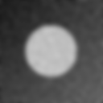

# Лабораторная работа № 4. Исследование операций обработки изображений в Engee

Вариант 15.

## 1. Контекст варианта

- Сцена: «сильный шум»:шум 0,10
- Операция: фильтр Гаусса, σ = 3
- Обязательный эксперимент: Шум сильный: разброс результатов больше, а выигрыш от подавления шума максимален - оцените, где предел. Примените фильтр Гаусса (σ = 3) и определите, где заканчивается польза сглаживания и начинается потеря деталей
- Критерий оценки: Гипотеза и практический допуск записаны до запуска; PSNR посчитан относительно эталона своей операции; вывод о пользе основан на ΔPSNR, а не на критерии 2s.
- Ограничение или риск: Сильное сглаживание разрушает мелкие детали: не судите по одной метрике, смотрите на энергию границ.

## 2. Цель, сцена, операция, гипотеза и допуск

- **Цель**: Исследовать, как типовые операции обработки - сглаживание, повышение резкости, выделение границ, бинаризация и морфология - влияют на изображение, и научиться оценивать их пользу измеримо: относительно эталона, а не «на глаз».
- **Сцена**: «сильный шум»:шум 0,10
- **Операция**: фильтр Гаусса, σ = 3
- **Гипотеза**: при сильном шуме (σₙ = 0,10) выигрыш от подавления шума максимален, поэтому фильтр Гаусса с σ = 3 должен улучшить PSNR относительно чистой сцены по сравнению с исходным зашумлённым изображением. Однако сильное сглаживание размывает границу диска, поэтому энергия границ после фильтра заметно упадёт, а контраст снизится. Ожидается, что PSNR вырастет, но ценой потери резкости границ. **Дата записи**: 2026-10-21 18:57:41 UTC
- **Допуск**: Операция полезна при ΔPSNR ≥ +1 дБ, а вредна при ΔPSNR ≤ −1 дБ. **Дата записи**: 2026-10-21 18:57:42 UTC

## 3. Данные и ограничения

### Данные файла "lab04_lib.jl"

```julia
using Images, Random, Statistics, SHA
isdefined(Main, :psnr_db) || include("lab03_lib.jl")

# Серая сцена n×n: тёмный диагональный градиент фона + яркий круг (диск) + (необязательно) шахматная добавка + гауссов шум.
# Случайные числа — из локального генератора MersenneTwister(seed). При noise = 0 получается «чистая» сцена (эталон).
function make_gray4(seed::Integer; n::Int=128, bg::Tuple{Float64,Float64}=(0.10, 0.40), disc::Float64=0.75, noise::Float64=0.05, checker::Int=0)
    rng = MersenneTwister(seed)
    x = zeros(n, n)
    for i in 1:n, j in 1:n
        v = bg[1] + (bg[2] - bg[1]) * (i + j) / (2n)
        if checker > 0 && (div(i - 1, checker) + div(j - 1, checker)) % 2 == 0
            v += 0.10
        end
        if (i - n ÷ 2)^2 + (j - n ÷ 2)^2 <= (n ÷ 4)^2
            v = disc
        end
        x[i, j] = clamp(v + noise * randn(rng), 0, 1)
    end
    return x
end

# Истинная маска диска (эталон сегментации).
truth_mask(n::Int=128) = [(i - n ÷ 2)^2 + (j - n ÷ 2)^2 <= (n ÷ 4)^2 for i in 1:n, j in 1:n]

# Пять сцен (контексты вариантов).
scene4(c) = c == 1 ? (noise=0.02, checker=0, disc=0.75, bg=(0.10, 0.40)) : c == 2 ? (noise=0.05, checker=0, disc=0.75, bg=(0.10, 0.40)) : c == 3 ? (noise=0.10, checker=0, disc=0.75, bg=(0.10, 0.40)) : c == 4 ? (noise=0.05, checker=8, disc=0.75, bg=(0.10, 0.40)) : (noise=0.03, checker=0, disc=0.55, bg=(0.35, 0.50))
clean4(c) = make_gray4(1; merge(scene4(c), (noise=0.0,))...)

# Операции.
gauss4(x, s) = imfilter(x, Kernel.gaussian(s))
box4(x, k) = mapwindow(mean, x, (k, k))
unsharp4(x) = clamp.(x .+ (x .- gauss4(x, 1)), 0, 1)
sobelmag(x) = (g = imgradients(x, KernelFactors.sobel); hypot.(g[1], g[2]))
edge_energy(x) = mean(sobelmag(x))
otsu_mask(x) = x .> otsu_threshold(Gray.(x))
open_mask(bw) = dilate(erode(bw))
iou(a, b) = sum(a .& b) / sum(a .| b)

# Пара «результат / базовый вариант / эталон» для воздействия k = 1..6 (нормированные значения в [0,1]).
function pair4(x, clean, k)
    if k <= 4
        res = k == 1 ? box4(x, 5) : k == 2 ? gauss4(x, 1) : k == 3 ? gauss4(x, 3) : unsharp4(x)
        return (res, x, clean)
    elseif k == 5
        cm = maximum(sobelmag(clean))
        nrm(z) = min.(sobelmag(z) ./ cm, 1.0)
        return (nrm(gauss4(x, 1)), nrm(x), nrm(clean))
    else
        bw = otsu_mask(x)
        return (Float64.(open_mask(bw)), Float64.(bw), Float64.(truth_mask(size(x, 1))))
    end
end

# Сводка варианта n = 1..30 по серии seed: метрики psnr (относительно эталона), edge (энергия границ результата), contrast (стандартное отклонение).
# Для каждой: база, разброс s, значение после воздействия, Δ, |Δ|/s, признак |Δ| > 2s. Для воздействия 6 дополнительно IoU с истинной маской.
function variant_summary4(n; seeds=101:105)
    q, r = divrem(n - 1, 6); c, k = q + 1, r + 1
    clean = clean4(c)
    B = Dict(:psnr => Float64[], :edge => Float64[], :contrast => Float64[])
    A = Dict(:psnr => Float64[], :edge => Float64[], :contrast => Float64[])
    ious = Float64[]
    for s in seeds
        x = make_gray4(s; scene4(c)...)
        res, base, ref = pair4(x, clean, k)
        push!(B[:psnr], psnr_db(base, ref)); push!(A[:psnr], psnr_db(res, ref))
        push!(B[:edge], edge_energy(base)); push!(A[:edge], edge_energy(res))
        push!(B[:contrast], std(base)); push!(A[:contrast], std(res))
        k == 6 && push!(ious, iou(open_mask(otsu_mask(x)), truth_mask(size(x, 1))))
    end
    rows = Any[]
    for m in (:psnr, :edge, :contrast)
        d = mean(A[m]) - mean(B[m]); sb = std(B[m])
        push!(rows, (m, mean(B[m]), sb, mean(A[m]), d, abs(d) / sb, abs(d) > 2 * sb))
    end
    return (variant=n, ctx=c, fac=k, iou=isempty(ious) ? NaN : mean(ious), rows=rows)
end
```

### Ограничение

Сильное сглаживание разрушает мелкие детали: не судить по одной метрике, смотреть на энергию границ.

## 4. Среда и версия

**Дата**: 2026-10-15
**Версия среды**: Engee 26.9.2-H4
**Версия Julia**: v"1.12.4"
**Пакеты**: Images, Random, Statistics, SHA
**Учебная библиотека**: lab03_lib.jl, lab04_lib.jl

## 5. Ход работы

### Создание чистой и зашумленной сцен

**Создание чистой сцены**
```julia
clean = clean4(3)
```

Массив чистой сцены размером 128x128 с *seed*: 101
```text
128×128 Matrix{Float64}:
 0.102344  0.103516  0.104688  0.105859  …  0.248828  0.25      0.251172
 0.103516  0.104688  0.105859  0.107031     0.25      0.251172  0.252344
 0.104688  0.105859  0.107031  0.108203     0.251172  0.252344  0.253516
 0.105859  0.107031  0.108203  0.109375     0.252344  0.253516  0.254688
 0.107031  0.108203  0.109375  0.110547     0.253516  0.254688  0.255859
 0.108203  0.109375  0.110547  0.111719  …  0.254688  0.255859  0.257031
 0.109375  0.110547  0.111719  0.112891     0.255859  0.257031  0.258203
 0.110547  0.111719  0.112891  0.114063     0.257031  0.258203  0.259375
 0.111719  0.112891  0.114063  0.115234     0.258203  0.259375  0.260547
 0.112891  0.114063  0.115234  0.116406     0.259375  0.260547  0.261719
 0.114063  0.115234  0.116406  0.117578  …  0.260547  0.261719  0.262891
 0.115234  0.116406  0.117578  0.11875      0.261719  0.262891  0.264063
 0.116406  0.117578  0.11875   0.119922     0.262891  0.264063  0.265234
 ⋮                                       ⋱  ⋮                   
 0.238281  0.239453  0.240625  0.241797     0.384766  0.385938  0.387109
 0.239453  0.240625  0.241797  0.242969     0.385938  0.387109  0.388281
 0.240625  0.241797  0.242969  0.244141     0.387109  0.388281  0.389453
 0.241797  0.242969  0.244141  0.245313     0.388281  0.389453  0.390625
 0.242969  0.244141  0.245313  0.246484  …  0.389453  0.390625  0.391797
 0.244141  0.245313  0.246484  0.247656     0.390625  0.391797  0.392969
 0.245313  0.246484  0.247656  0.248828     0.391797  0.392969  0.394141
 0.246484  0.247656  0.248828  0.25         0.392969  0.394141  0.395313
 0.247656  0.248828  0.25      0.251172     0.394141  0.395313  0.396484
 0.248828  0.25      0.251172  0.252344  …  0.395313  0.396484  0.397656
 0.25      0.251172  0.252344  0.253516     0.396484  0.397656  0.398828
 0.251172  0.252344  0.253516  0.254688     0.397656  0.398828  0.4
```

**Создание зашумленной сцены**
```julia
noisy = make_gray4(101; scene4(3)...)
```

Массив зашумленной сцены размером 128x128 с *seed*: 101
```text
128×128 Matrix{Float64}:
 0.216292    0.0746926  0.144241   …  0.285341  0.239527   0.193758
 0.195167    0.251429   0.0234619     0.261986  0.0742352  0.314678
 0.0714959   0.356975   0.311055      0.190621  0.355105   0.176433
 0.177638    0.124607   0.200539      0.184704  0.317805   0.289503
 0.323532    0.143195   0.188704      0.187481  0.145351   0.185991
 0.17532     0.0        0.174974   …  0.405511  0.322624   0.26955
 0.0         0.145934   0.0253419     0.236114  0.239286   0.399083
 0.0643201   0.189617   0.0           0.285426  0.294835   0.340526
 0.119913    0.0        0.121654      0.456338  0.191447   0.292651
 0.129607    0.0605784  0.279145      0.365076  0.0        0.298653
 0.00745358  0.126317   0.283202   …  0.305883  0.194625   0.156463
 0.173748    0.101587   0.225705      0.288027  0.284825   0.106848
 0.0         0.135266   0.243932      0.120355  0.156648   0.273702
 ⋮                                 ⋱  ⋮                    
 0.309431    0.111606   0.255004      0.403805  0.298498   0.299326
 0.306907    0.344398   0.169802      0.277261  0.411348   0.388347
 0.146442    0.261196   0.283132      0.328634  0.489694   0.328256
 0.243702    0.11788    0.189798      0.522595  0.372106   0.301657
 0.0         0.184171   0.303508   …  0.461961  0.366958   0.662351
 0.0538859   0.319356   0.29427       0.284054  0.411307   0.592745
 0.0840299   0.266644   0.166833      0.224637  0.364236   0.158439
 0.296172    0.400938   0.259321      0.473324  0.380219   0.44454
 0.304337    0.0733395  0.557889      0.441511  0.538336   0.406609
 0.184855    0.300512   0.112147   …  0.376217  0.401038   0.37517
 0.234373    0.171748   0.293045      0.219174  0.294986   0.364811
 0.263768    0.0636031  0.109127      0.279337  0.400425   0.190491
```

### Вычисление PSNR и сравнение с теоретической оценкой

Вычисление PSNR зашумлённой сцены относительно эталона
```julia
psnr_noisy = psnr_db(noisy, clean)
theory     = -20 * log10(scene4(3).noise)

println("PSNR(noisy, clean)  = ", round(psnr_noisy; digits=4), " дБ")
println("Теория −20·lg(0.10) = ", round(theory; digits=4), " дБ")
println("Расхождение         = ", round(abs(psnr_noisy - theory); digits=4), " дБ")
```

### Применение операции Гаусса и сохранение 3 .png файлов

По варианту дана операция Гаусса σ = 3

Создание сцены на основе операции Гаусса σ = 3
```julia
filtered = gauss4(noisy, 3)
```

Массив результата вычисления на основе операции Гаусса
```text
128×128 Matrix{Float64}:
 0.156331  0.14138   0.127479  0.11648   …  0.243396  0.237997  0.23333
 0.155434  0.142548  0.130435  0.120313     0.245535  0.242102  0.239149
 0.152882  0.142037  0.131776  0.12273      0.250044  0.248407  0.246887
 0.148543  0.139792  0.131487  0.123872     0.25578   0.255849  0.255657
 0.141334  0.135005  0.129003  0.123239     0.262477  0.263609  0.264097
 0.13388   0.129813  0.126003  0.122175  …  0.268665  0.2702    0.270713
 0.125546  0.124141  0.122897  0.121303     0.272898  0.274452  0.274756
 0.119591  0.120309  0.121186  0.121479     0.274848  0.275668  0.275041
 0.116555  0.11891   0.121318  0.122937     0.273087  0.27227   0.269985
 0.117629  0.120585  0.12365   0.125854     0.270784  0.26781   0.263598
 0.120595  0.123772  0.126991  0.129226  …  0.267696  0.262813  0.257007
 0.124259  0.127021  0.129811  0.131576     0.264422  0.258177  0.251446
 0.128537  0.130048  0.131586  0.132225     0.261595  0.254228  0.246828
 ⋮                                       ⋱  ⋮                   
 0.219772  0.225693  0.231647  0.237294     0.374592  0.374533  0.37492
 0.220479  0.227102  0.233628  0.239698     0.376626  0.377616  0.378835
 0.216239  0.224876  0.233196  0.240814     0.380043  0.382418  0.384738
 0.211709  0.222196  0.232193  0.241264     0.383157  0.386558  0.389552
 0.207918  0.220015  0.231492  0.241807  …  0.387123  0.391109  0.394421
 0.207283  0.219668  0.231448  0.242182     0.388616  0.392192  0.394834
 0.209268  0.22097   0.232238  0.242798     0.389612  0.391719  0.392674
 0.214284  0.224193  0.234001  0.243688     0.387833  0.387     0.3848
 0.219293  0.226806  0.234772  0.243555     0.384829  0.379727  0.373107
 0.223783  0.228556  0.234448  0.242222  …  0.380289  0.370438  0.358976
 0.225267  0.227726  0.231954  0.239171     0.374399  0.35979   0.343399
 0.225569  0.225613  0.22808   0.234768     0.367632  0.347923  0.326148
```

Сохранение 3 .png файлов
```julia
tag = "v15_seed$(101)"
save("$(tag)_noisy.png",    noisy)
save("$(tag)_filtered.png", filtered)
save("$(tag)_clean.png",    clean)
```

### Выполнение variant_summary4(15) и создание таблицы метрик

```julia
res = variant_summary4(15)

println("Вариант: ", res.variant)
println("Сцена (ctx):     ", res.ctx)
println("Операция (fac):  ", res.fac)
println("IoU (для k = 6): ", res.iou)
println()
println("Метрика    | база     | s        | после    | Δ        | |Δ|/s   | |Δ|>2s")
println("-"^85)
for r in res.rows
    m, base, s, after, Δ, ratio, sig = r
    println(rpad(string(m), 11),
            "| ", rpad(round(base;  digits=4), 9),
            "| ", rpad(round(s;     digits=5), 9),
            "| ", rpad(round(after; digits=4), 9),
            "| ", rpad(round(Δ;     digits=4), 9),
            "| ", rpad(round(ratio; digits=2), 7),
            "| ", sig ? "да" : "нет")
end
```

## 6. Результаты

### Таблица метрик в результате работы функции variant_summary4(15) из исходного файла lab04_lib.jl

| Метрика | база | s | после | Δ | \|Δ\|/s | \|Δ\| > 2s |
|---|---|---|---|---|---|---|
| **PSNR** (дБ) | 20,1212 | 0,06176 | 26,6411 | **+6,5199** | 105,58 | да |
| **edge** (энергия границ) | 0,0587 | 0,00054 | 0,0090 | **−0,0497** | 91,91 | да |
| **contrast** (std) | 0,2285 | 0,00087 | 0,1944 | **−0,0342** | 39,10 | да |

Фильтр Гаусса σ = 3 оказал статистически значимое влияние на все три метрики (критерий |Δ| > 2s выполнен везде). Однако направление этого влияния различается: PSNR вырос на 6,52 дБ, что свидетельствует о подавлении шума, в то время как энергия границ упала на 84,7%, а контраст - на 14,9%, что указывает на потерю деталей. Малый разброс s (около 0,06 дБ для PSNR) говорит о высокой стабильности результатов между seed, однако он же делает критерий 2s нечувствительным к смыслу операции. Поэтому итоговый вывод о пользе операции (ΔPSNR = +6,52 дБ > +1 дБ) делается на основе практического допуска, а не формальной статистической значимости.

### Проверка теории

| Показатель | Значение |
|---|---|
| PSNR(noisy, clean), seed 101 | 20,0703 дБ |
| Теоретическая оценка −20·lg(0,10) | 20,0 дБ |
| Расхождение | 0.0703 дБ |

Основываясь на вычислении PSNR и сравнении ее с теоретической оценкой, можно сказать, что шум σₙ = 0,10 ведёт себя как чистый гауссов шум, а ограничение диапазона `[0, 1]` практически не влияет.

### Созданные сцены

Было создано 3 сцены (зашумленная, чистая, на основе операции Гаусса σ = 3) на seed = 101

**Созданная чистая сцена**, *seed:101*:


**Созданная зашумленная сцена**, *seed:101*:


**Созданная сцена на основе операции Гаусса σ = 3**, *seed:101*:


В результате операции Гаусса фильтр подавил высокочастотный шум. Изображение стало визуально «гладким». Однако наглядно виден компромисс «шум/детали»: граница диска стала сильно размытой (нечеткой), а контраст между диском и фоном снизился, что соответствует гипотезе.

## 7. Анализ

### Польза операции

При **практическом допуске** (записан до запуска, раздел 2):

**ΔPSNR = +6,52 дБ** > +1 дБ → **операция полезна** для сцены 3.

### Компромисс «шум / детали»

**Таблица изменений**:

| Метрика | до | после | относительное изменение |
|---|---|---|---|
| PSNR | 20,12 дБ | 26,64 дБ | **+32,4%** |
| edge | 0,0587 | 0,0090 | **−84,7%** |
| contrast | 0,2285 | 0,1944 | **−14,9%** |

- **PSNR вырос на 6,52 дБ** - шум подавлен сильно, изображение стало ближе к эталону по пикселям.
- **Энергия границ упала в 6,5 раза** (на 85%). Граница круга стала размытой.
- **Контраст упал на 15%** - изображение стало «мягче», мелкие детали исчезли.

### Угрозы валидности

**Ограничения синтетической сцены**

- Сцена - один круг на диагональном градиенте. Реальные изображения содержат текстуры, множество объектов, переменное освещение.
- Вывод справедлив **только для этой сцены** и не переносится автоматически на фотографии, медицинские снимки и т. п.
- Граница здесь одна и хорошо определена; на сложных сценах потеря мелких деталей при σ = 3 была бы критичнее.

**Ограничения серии seed**

- 5 значений seed 101…105 - небольшая серия.
- `s` мало → критерий 2s срабатывает автоматически и **не различает варианты**.
- В таблице: `|Δ| > 2s = да` для всех трёх метрик, хотя знаки Δ разные (PSNR растёт, edge и contrast падают).

**Ограничения допуска**

- Допуск ±1 дБ выбран условно. При ΔPSNR = +6,52 дБ классификация «полезна» устойчива к сдвигу допуска до ±2 дБ.
- Для пограничных эффектов (±1 дБ) ответ зависел бы от выбора допуска.

**Ограничения реализации**

- `psnr_db` должна получать **чистую сцену `clean4(3)`** вторым аргументом. Иначе ΔPSNR окажется завышенной (≈ 40+ дБ) и вывод будет ложным.
- Параметры фильтра (σ = 3, размер ядра, способ обработки краёв).
- Seed 101…105 - общий для всей серии.

**Ограничения интерпретации**

- «Полезна» - вывод **только про PSNR**. По энергии границ операция **вредна**: edge упал в 6,5 раз.
- Формулировка «полезна» означает «полезна, если цель - минимальная пиксельная ошибка при сильном шуме». Если цель - сохранить границы, σ = 3 - плохой выбор, лучше σ = 1.

## 8. Вывод

PSNR зашумлённого изображения относительно чистой сцены составил в среднем **20,12 дБ**, что согласуется с теоретической оценкой −20·lg(0,10) = 20,0 дБ. После применения фильтра Гаусса σ = 3 PSNR вырос до **26,64 дБ**, то есть **ΔPSNR = +6,52 дБ** при разбросе между seed s = 0,062 дБ (|Δ|/s = 105,6). По практическому допуску (±1 дБ) операция классифицируется как **полезна**.
Одновременно энергия границ упала с 0,0587 до 0,0090 (в 6,5 раз, −84,7%), а контраст - с 0,2285 до 0,1944 (−14,9%). Это демонстрирует компромисс «шум / детали»: при σₙ = 0,10 выигрыш от подавления шума (+6,52 дБ) превышает потерю на границах, и сглаживание σ = 3 оправдано по PSNR. Однако резкость границы круга существенно снижена, что критично, если целью является последующая сегментация или выделение контуров.
Критерий 2s формально срабатывает для всех трёх метрик, но это отражает лишь малый разброс между seed, а не различает пользу и вред: знаки Δ у PSNR (+6,52) и у edge/contrast (−0,0497 и −0,0342) противоположны. Вывод о пользе основан на ΔPSNR и практическом допуске, а не на статистической значимости.

## 9. Ссылка на архив
https://disk.yandex.ru/d/9T7xBEc4LdwfsA

## 10. Вопрос для обсуждения

### Суть вопроса

При каком уровне шума (из сцен 1–3) усредняющий фильтр начинает улучшать PSNR? Проверьте гипотезу на вариантах 7 и 13 и объясните результат.

### Гипотеза

Чем выше уровень шума, тем выше ΔPSNR. Так как при уровне шума (0.02) ΔPSNR ≈ −4,79 дБ (исходя из методички), то при его увеличении будет происходить и увеличение ΔPSNR и на каком то уровне шума будет момент перегиба.
Предпологаемый перегиб произойдет на уровне шума: 0.05 (Вариант 7).

### Выполнение и результат

При выполнении кода:
```julia
res_var1  = variant_summary4(1)   
res_var7  = variant_summary4(7)   
res_var13 = variant_summary4(13)  

function get_dpsnr(res)
    row = res.rows[1] 
    return row[5]
end

println("Сцена 1 (noise 0.02) + Box 5x5: ΔPSNR = ", round(get_dpsnr(res_var1), digits=2), " дБ")
println("Сцена 2 (noise 0.05) + Box 5x5: ΔPSNR = ", round(get_dpsnr(res_var7), digits=2), " дБ")
println("Сцена 3 (noise 0.10) + Box 5x5: ΔPSNR = ", round(get_dpsnr(res_var13), digits=2), " дБ")
```

результаты показали:
```text
Сцена 1 (noise 0.02) + Box 5x5: ΔPSNR = -4.79 дБ
Сцена 2 (noise 0.05) + Box 5x5: ΔPSNR = 2.87 дБ
Сцена 3 (noise 0.10) + Box 5x5: ΔPSNR = 7.83 дБ
```

### Вывод

Гипотеза подтвердилась: чем сильнее шум, тем выше ΔPSNR (польза от сглаживания). «Точка перегиба», после которой усредняющий фильтр 5×5 начинает улучшать PSNR, находится между уровнями шума 0,02 и 0,05 (поскольку уже при σₙ = 0,05 получаем уверенный прирост ΔPSNR = +2,87 дБ). При слабом шуме применение грубого сглаживания нецелесообразно, а при умеренном и сильном - оно дает значительный выигрыш в метрике PSNR.